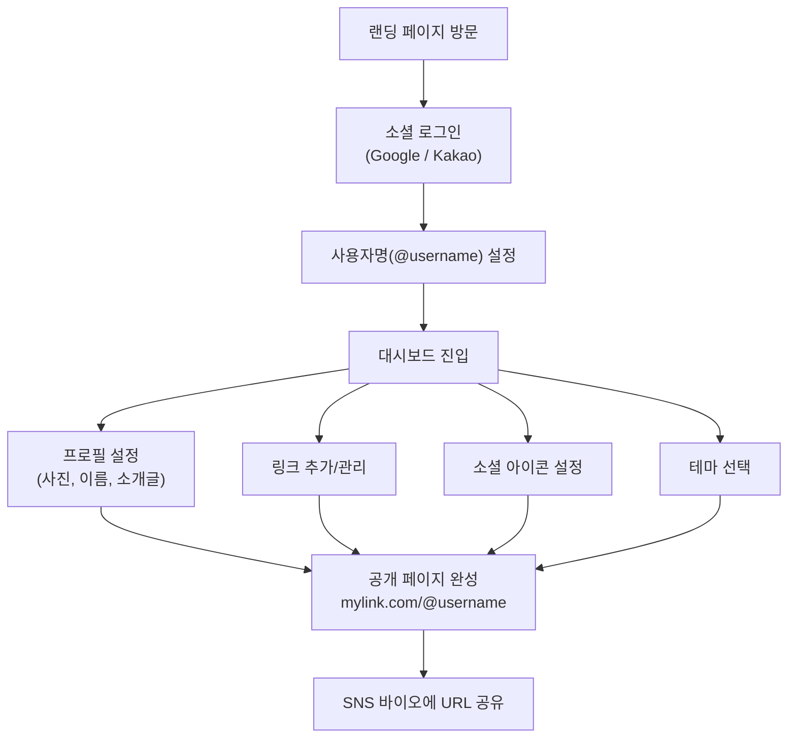
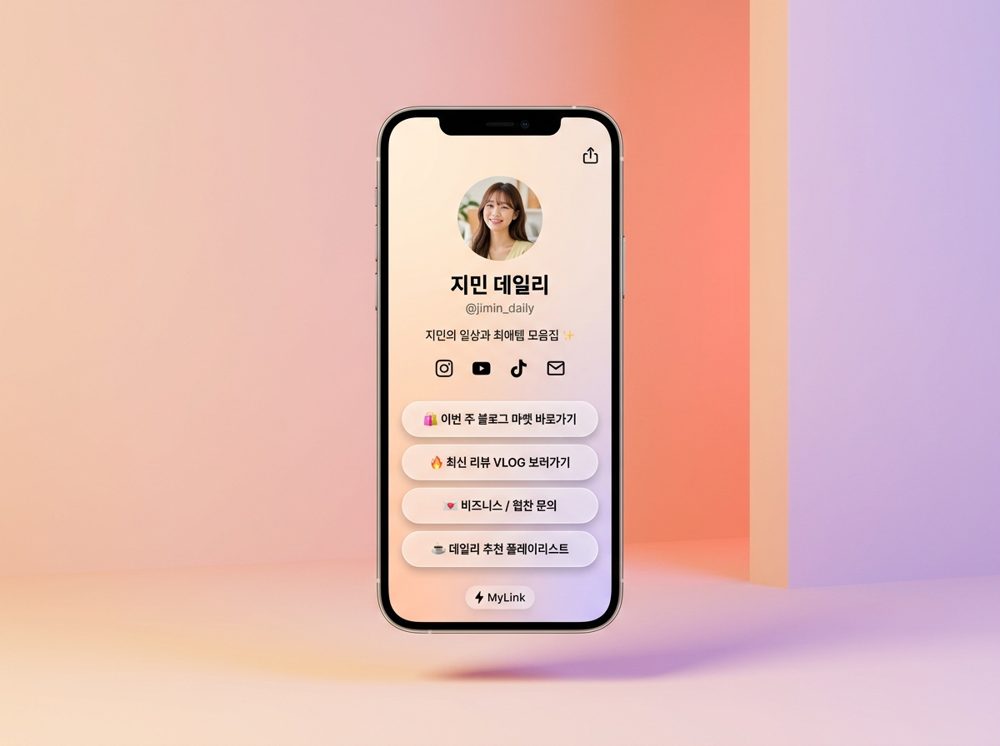
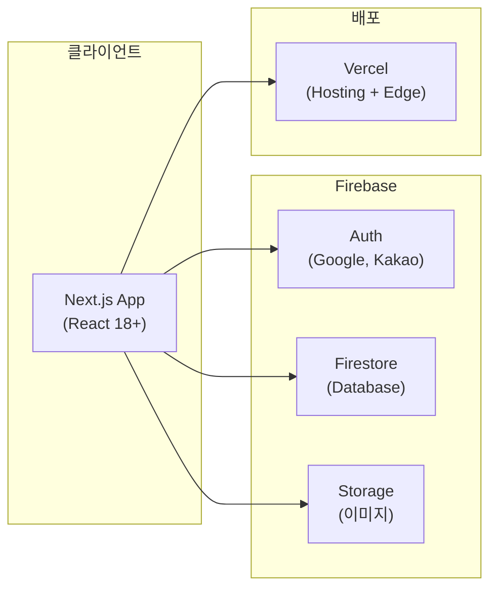

# 📄 마이링크(MyLink) — PRD (기능 정의서)

> **버전:** v1.0 (MVP)  
> **작성일:** 2026-11-07  
> **상태:** Draft

---

## 1. 제품 개요

### 1.1 한 줄 요약
**마이링크**는 인플루언서·크리에이터가 자신의 모든 링크를 하나의 심플한 페이지에 모아 공유할 수 있는 링크-인-바이오 서비스입니다.

### 1.2 핵심 가치
| 키워드 | 설명 |
|---|---|
| **초심플** | 가입 후 30초 안에 링크 페이지를 만들 수 있어야 한다 |
| **크리에이터 중심** | 인스타그램, 유튜브 바이오에 바로 걸 수 있는 깔끔한 공개 페이지 |
| **모바일 퍼스트** | 방문자의 90%가 모바일 — 모바일에서 완벽하게 동작 |

### 1.3 타겟 사용자
- **1차 타겟:** SNS 인플루언서, 유튜버, 틱톡 크리에이터
- **2차 타겟:** 프리랜서, 1인 브랜드 운영자
- 주요 연령대: 18~35세
- 주요 사용 환경: 모바일 웹 브라우저

---

## 2. 사용자 흐름 (User Flow)



---

## 3. 사용자 페르소나 및 시나리오 (User Scenarios)

### 3.1 페르소나 정의

| 구분 | 페르소나 A (메인 크리에이터) | 페르소나 B (파워 크리에이터) | 페르소나 C (엔드유저 / 방문자) |
|---|---|---|---|
| **이름/나이** | 김지민 (24세, 인스타 라이프스타일 크리에이터) | 박민수 (30세, 테크/리뷰 유튜버) | 이수현 (21세, 대학생 / SNS 팔로워) |
| **주요 활동** | 인스타그램 릴스, 블로그 마켓 공구 운영 | 주 2회 유튜브 업로드, 기기 협찬 리뷰 | 인스타그램 탐색 및 유튜브 구독 영상 소비 |
| **핵심 니즈** | "복잡한 설정 없이 인스타 프로필에 걸 1개의 링크 페이지가 필요해요." | "새 영상이 올라올 때마다 스마트폰으로 링크 순서를 제일 위로 올려야 해요." | "인스타 프로필 링크를 눌렀을 때 버벅이지 않고 바로 열려야 해요." |

---

### 3.2 핵심 사용자 시나리오

#### 시나리오 1: 1분 만에 첫 링크 페이지 개설 및 바이오 등록 (온보딩)
- **주인공:** 페르소나 A (김지민)
- **상황:** 인스타그램 프로필에 유튜브, 블로그 마켓 링크를 한 번에 노출하고 싶음.
- **진행 흐름:**
  1. 모바일 브라우저로 마이링크 랜딩 페이지에 접속 후 `카카오로 시작하기` 버튼을 누른다.
  2. 인스타그램 계정명과 일치하는 `@jimin_daily`를 사용자명으로 입력해 중복 확인 후 생성한다.
  3. 프로필 편집에서 프로필 사진을 올리고, 이름("지민 데일리")과 소개글("지민의 일상과 최애템 모음집✨")을 입력한다.
  4. 인스타그램, 유튜브 소셜 아이콘 URL을 등록한다.
  5. `링크 추가` 버튼으로 "이번 주 블로그 공구 마켓"과 "최신 VLOG 보러가기" 2개 링크를 등록한다.
  6. 따뜻하고 감성적인 `Sunset` 테마를 선택하고 실시간 미리보기로 확인한다.
  7. 상단의 내 링크 주소(`mylink.com/@jimin_daily`)를 원클릭 복사하여 인스타그램 프로필 링크 란에 붙여넣는다.
- **결과:** 가입부터 SNS 바이오 등록까지 2분 이내에 완료.

#### 시나리오 2: 새 콘텐츠 업로드 후 링크 추가 및 우선순위 조정 (일상 관리)
- **주인공:** 페르소나 B (박민수)
- **상황:** 새로운 IT 기기 언박싱 유튜브 영상을 방금 공개하여, 마이링크 최상단에 배치하고 종료된 이벤트 링크는 비공개하고 싶음.
- **진행 흐름:**
  1. 모바일로 마이링크 대시보드에 로그인한다.
  2. `링크 추가`를 눌러 신규 유튜브 영상 링크와 제목("🔥 신형 M4 맥북 프로 1주일 실사용기")을 입력한다.
  3. 방금 추가한 링크의 좌측 드래그 핸들을 터치하여 리스트 맨 위(1번 자리)로 끌어올린다.
  4. 지난주 마감된 "구독자 나눔 이벤트" 링크의 활성화 토글을 OFF로 전환하여 비공개 처리한다.
- **결과:** 별도의 재배포 과정 없이 실시간으로 공개 페이지(`mylink.com/@tech_min`)의 최상단에 새 영상 링크가 노출되고, 마감된 이벤트는 노출되지 않음.

#### 시나리오 3: 팔로워의 프로필 방문 및 링크 탐색 (방문자 경험)
- **주인공:** 페르소나 C (이수현)
- **상황:** 지민의 인스타그램 릴스를 보다가 착용한 옷 정보를 확인하기 위해 프로필 링크를 클릭함.
- **진행 흐름:**
  1. 인스타그램 앱 내 브라우저에서 `mylink.com/@jimin_daily`를 탭한다.
  2. 1.5초 이내에 지민의 프로필과 버튼 목록이 깔끔하게 로딩된다.
  3. 눈에 띄는 첫 번째 버튼인 "이번 주 블로그 공구 마켓"을 탭한다.
  4. 지연이나 팝업 광고 없이 바로 해당 블로그 마켓 페이지로 전환된다.
- **결과:** 군더더기 없는 초고속 탐색으로 원하는 정보에 바로 도달.

#### 시나리오 4: 브랜딩 리뉴얼을 위한 테마 및 프로필 변경
- **주인공:** 페르소나 A (김지민)
- **상황:** 계절 변화에 맞춰 페이지 분위기를 시크한 다크 톤으로 변경하고 싶음.
- **진행 흐름:**
  1. 대시보드의 테마 설정 영역으로 이동한다.
  2. 기본 제공되는 테마 목록 중 `Midnight` 테마를 선택한다.
  3. 우측 모바일 폰 프레임 미리보기를 통해 어두운 배경에 흰색 버튼이 조화로운지 확인한다.
  4. `저장`을 누르면 즉시 모든 방문자에게 변경된 테마가 적용된다.

---

## 4. 기능 명세

### 4.1 회원가입 / 로그인

| 항목 | 상세 |
|---|---|
| 로그인 방식 | Google OAuth, Kakao OAuth |
| 온보딩 | 최초 로그인 시 **사용자명(username)** 설정 필수 |
| 사용자명 규칙 | 영문 소문자, 숫자, 밑줄(`_`), 마침표(`.`) 허용 / 3~20자 / 중복 불가 |
| 세션 | Firebase Auth 토큰 기반, 자동 로그인 유지 |

### 4.2 공개 페이지 (Public Page)

> 방문자가 보는 `mylink.com/@username` 페이지



#### 구성 요소 (위→아래 순서)
1. **프로필 영역**
   - 프로필 사진 (원형, 최대 2MB)
   - 이름 (최대 30자)
   - 소개글 (최대 80자)
2. **소셜 아이콘 바**
   - 지원 플랫폼: Instagram, YouTube, TikTok, X(Twitter), Facebook, GitHub, Email
   - 아이콘 클릭 시 해당 URL로 이동
   - 최대 7개 표시
3. **링크 리스트**
   - 각 링크: 제목(최대 40자) + URL
   - 클릭 시 새 탭으로 이동
   - 비활성화 토글 가능 (비공개 처리)

#### 비기능 요구사항
- 로딩 속도: FCP(First Contentful Paint) **1.5초 이내**
- SSR(Server-Side Rendering) 또는 SSG(Static Site Generation) 적용
- Open Graph 메타 태그 자동 생성 (SNS 공유 미리보기)

### 4.3 대시보드 (관리 페이지)

> 로그인한 사용자가 자신의 페이지를 편집하는 화면

#### 4.3.1 프로필 관리
| 기능 | 상세 |
|---|---|
| 프로필 사진 업로드 | JPEG, PNG, WebP / 최대 2MB / Firebase Storage 저장 |
| 이름 수정 | 실시간 미리보기 반영 |
| 소개글 수정 | 실시간 미리보기 반영 |

#### 4.3.2 링크 관리
| 기능 | 상세 |
|---|---|
| 링크 추가 | 제목 + URL 입력, URL 유효성 검증 |
| 링크 수정 | 인라인 편집 |
| 링크 삭제 | 확인 모달 후 삭제 |
| 순서 변경 | **드래그 앤 드롭** |
| 링크 활성/비활성 | 토글 스위치 — 비활성 시 공개 페이지에 미노출 |
| 링크 개수 제한 | 최대 **20개** (MVP) |

#### 4.3.3 소셜 아이콘 관리
| 기능 | 상세 |
|---|---|
| 플랫폼 선택 | 드롭다운에서 플랫폼 선택 후 URL 입력 |
| 순서 변경 | 드래그 앤 드롭 |
| 삭제 | 개별 삭제 가능 |

#### 4.3.4 테마 선택
| 기능 | 상세 |
|---|---|
| 프리셋 테마 | **5개** 제공 (아래 참고) |
| 적용 방식 | 선택 즉시 미리보기 반영 |
| 저장 | "저장" 버튼 클릭 시 반영 |

**기본 제공 테마:**

| # | 테마 이름 | 배경색 | 버튼 스타일 | 분위기 |
|---|---|---|---|---|
| 1 | Snow | `#FFFFFF` | 라운드, 검정 테두리 | 깔끔·미니멀 |
| 2 | Midnight | `#1A1A2E` | 라운드, 흰색 텍스트 | 다크·시크 |
| 3 | Sunset | `#FF6B6B → #FFC154` 그라디언트 | 둥근 필, 흰색 텍스트 | 따뜻·에너지 |
| 4 | Ocean | `#0F3460` | 둥근 필, 시안 액센트 | 차분·신뢰 |
| 5 | Blossom | `#FFF0F5` | 라운드, 핑크 액센트 | 부드럽·귀여운 |

#### 4.3.5 실시간 미리보기
- 대시보드 우측(데스크톱) 또는 하단 플로팅 버튼(모바일)에 **폰 프레임 미리보기** 표시
- 편집 내용 즉시 반영

### 4.4 계정 설정

| 기능 | 상세 |
|---|---|
| 사용자명 변경 | 중복 체크 후 변경 가능 (30일에 1회 제한) |
| 로그아웃 | 세션 종료 |
| 계정 삭제 | 확인 절차 후 모든 데이터 삭제 (30일 유예 기간) |

---

## 5. 기술 아키텍처



### 5.1 기술 스택

| 레이어 | 기술 | 비고 |
|---|---|---|
| **프레임워크** | Next.js 14+ (App Router) | SSR/SSG 활용 |
| **언어** | TypeScript | 타입 안전성 |
| **스타일링** | Tailwind CSS | 유틸리티 퍼스트 |
| **상태 관리** | React Context / Zustand | 경량 상태 관리 |
| **인증** | Firebase Auth | Google, Kakao Provider |
| **데이터베이스** | Cloud Firestore | NoSQL, 실시간 동기화 |
| **파일 저장** | Firebase Storage | 프로필 이미지 |
| **배포** | Vercel | Edge Network, 자동 배포 |
| **드래그 앤 드롭** | @dnd-kit/core | 접근성 지원 |

### 5.2 Firestore 데이터 모델

```
users/{userId}
├── username: string          // "@" 뒤의 고유 ID
├── displayName: string       // 표시 이름
├── bio: string               // 소개글
├── photoURL: string          // 프로필 사진 URL
├── theme: string             // 선택한 테마 ID
├── socialIcons: [            // 소셜 아이콘 배열
│     { platform, url, order }
│   ]
├── links: [                  // 링크 배열
│     { id, title, url, order, isActive }
│   ]
├── createdAt: timestamp
└── updatedAt: timestamp

usernames/{username}           // username 중복 방지용
└── userId: string
```

---

## 6. 페이지 구조 (라우팅)

| 경로 | 페이지 | 접근 권한 |
|---|---|---|
| `/` | 랜딩 페이지 (서비스 소개 + 가입 CTA) | Public |
| `/login` | 로그인 페이지 | Public |
| `/onboarding` | 사용자명 설정 | 인증 필요 |
| `/dashboard` | 대시보드 (링크/프로필 관리) | 인증 필요 |
| `/dashboard/settings` | 계정 설정 | 인증 필요 |
| `/@{username}` | 공개 프로필 페이지 | Public |

---

## 7. 비기능 요구사항 (NFR)

| 항목 | 목표 |
|---|---|
| **성능** | 공개 페이지 LCP ≤ 1.5초 (모바일 4G 기준) |
| **가용성** | 99.9% uptime (Vercel + Firebase SLA) |
| **SEO** | 각 공개 페이지별 Open Graph 메타 + 구조화된 데이터 |
| **접근성** | WCAG 2.1 AA 기본 준수 (키보드 탐색, 색상 대비) |
| **보안** | Firestore Security Rules로 본인 데이터만 수정 가능 |
| **반응형** | 320px ~ 1440px 해상도 대응 |
| **브라우저** | Chrome, Safari, Edge 최신 2개 버전 |

---

## 8. MVP 제외 항목 (Post-MVP 후보)

> [!NOTE]
> 아래 기능들은 MVP 이후 사용자 피드백을 반영하여 추가 검토합니다.

| 기능 | 우선순위 | 비고 |
|---|---|---|
| 링크 클릭 통계 / 애널리틱스 | 🔴 높음 | 1차 업데이트 후보 |
| 테마 상세 커스터마이징 (자유 색상) | 🟡 중간 | 유료 전환 시 차별점 |
| 커스텀 도메인 연결 | 🟡 중간 | 프로 플랜 기능 |
| 링크 예약 공개 (스케줄링) | 🟢 낮음 | |
| 유료 구독 플랜 | 🟡 중간 | 수익화 시점에 설계 |
| 민감 링크 경고 (19+) | 🟢 낮음 | |
| 링크 썸네일/아이콘 설정 | 🟡 중간 | |

---

## 9. 성공 지표 (KPI)

| 지표 | 목표 (출시 후 3개월) |
|---|---|
| 가입 사용자 수 | 1,000명 |
| 공개 페이지 생성 완료율 | 가입 대비 **70% 이상** |
| 공개 페이지 평균 링크 수 | 3개 이상 |
| 일간 공개 페이지 조회수 | 5,000 PV |
| 페이지 생성 소요 시간 | 첫 방문 → 공개까지 **2분 이내** |

---

## 10. 마일스톤

| 단계 | 기간 | 산출물 |
|---|---|---|
| **Phase 1 — 설계** | 1주 | 와이어프레임, DB 스키마 확정 |
| **Phase 2 — 개발** | 3~4주 | 인증, 대시보드, 공개 페이지, 테마 |
| **Phase 3 — QA/테스트** | 1주 | 크로스 브라우저, 모바일, 성능 |
| **Phase 4 — 런칭** | 1주 | 배포, 랜딩 페이지, 베타 오픈 |
| **총합** | **약 6~7주** | |

---

> [!IMPORTANT]
> 이 PRD는 MVP 범위를 정의합니다. 개발 착수 전 와이어프레임/디자인 시안 검토 단계를 거치는 것을 권장합니다.
